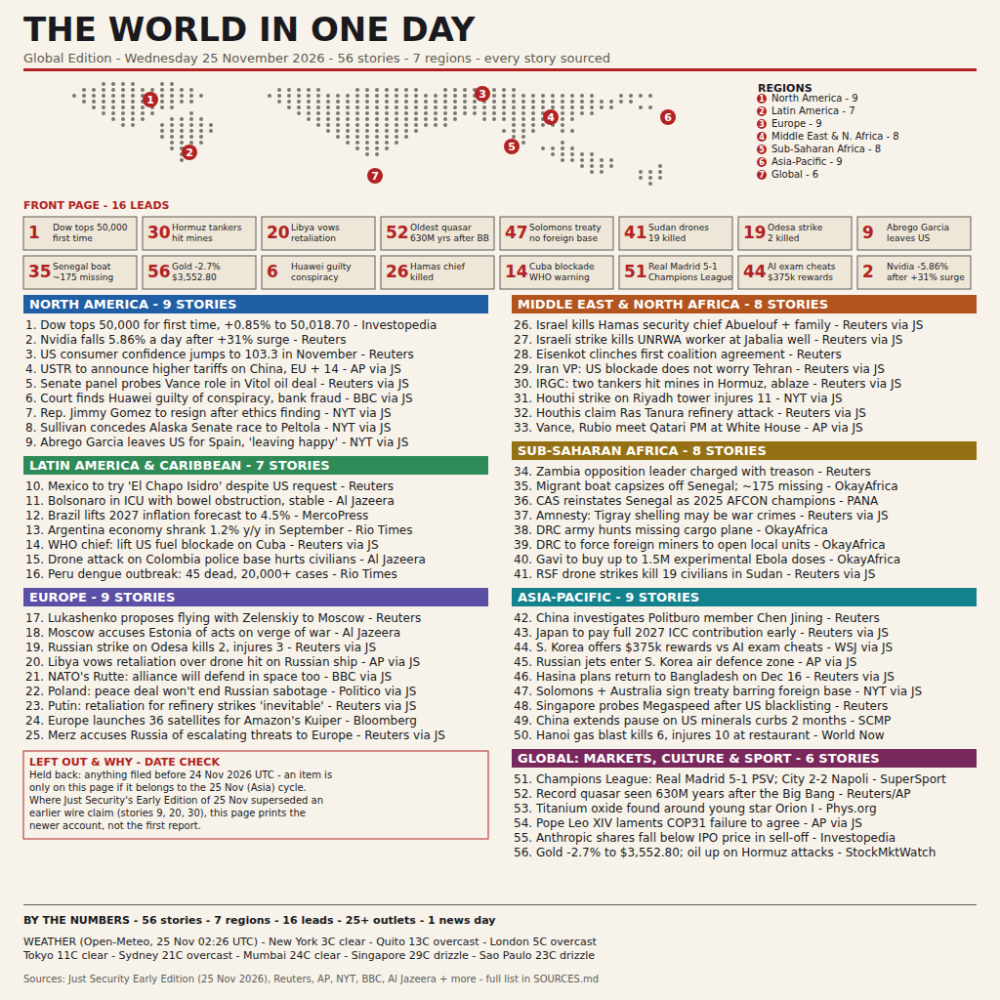

# The World in One Day — 25 November 2026

**Wednesday 25 November 2026 — the whole world in one image.**

## What it is

One 1024×1024 broadsheet poster summing up 25 November 2026's world news:

- **56 numbered stories across 7 regions** (North America 9, Latin
  America & Caribbean 7, Europe 9, Middle East & North Africa 8,
  Sub-Saharan Africa 8, Asia-Pacific 9, Global: Markets, Culture &
  Sport 6), each with its outlet cited on the poster.
- **Front page — 16 leads:** the Dow above 50,000 for the first time,
  two tankers mined in Hormuz, Libya's retaliation vow, the record
  quasar 'Dun Aonghasa', the Solomons–Australia treaty, and more.
- **Dot-matrix world map** with 7 numbered region pins + legend.
- **By-the-numbers** strip, **weather strip** (8 cities, Open-Meteo)
  and a **"left out & why"** date-check box.

Every story belongs to the 25 November 2026 news cycle (filed 24 Nov
2026 UTC = 25 Nov in Asia). Sixteen stories were refreshed against
Just Security's Early Edition of 25 Nov 2026 itself; where it
superseded an earlier wire claim (stories 9, 20, 30), the poster
prints the newer account. Full verification links are in
[SOURCES.md](SOURCES.md).

## How it is built

- `build_poster.py` — authoring tool: emits `poster.svg` from the
  verified story data (the SVG is a build artifact, not committed).
- `generate.mjs` — runs `build_poster.py`, then renders the SVG to
  `entry.png` (1024×1024) with headless Chromium.
- `main.ts` — the competition program: delivers `entry.png` byte for
  byte to the output directory and verifies the copy. It renders
  nothing, so the judged output is exactly the page above.

## License

MIT — see [LICENSE](LICENSE).

Final-entry resubmission, 27 Nov 2026: the best-graded version, re-entered unchanged — poster bytes identical.
